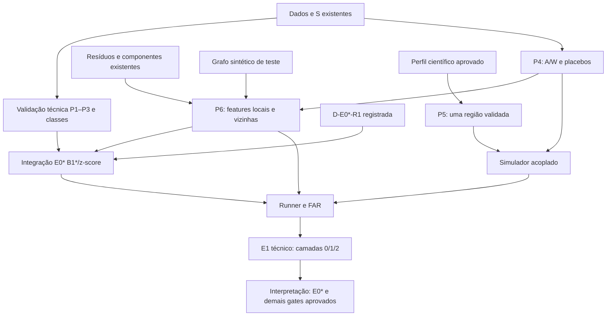

# HEADD-Series L0 Global Implementation Plan

## Estado vigente — 22/10/2026 (evidência P5/G4)

O [pacote P5/G4 para revisão científica](../../evidence/2026-10-22-p5-g4/README.md)
registra verificação nova dos bytes oficiais/rótulos/seis pares de medianas,
384 realizações mensais completas e replay exato sob perfil/seeds fixos.
Testes determinísticos (76) e suíte padrão (466, 1 excluído) passaram;
clipping e todos os denominadores foram publicados sem novo cutoff.
G4 segue pendente de revisão científica explícita e interpretação bloqueada;
E0*/FAR reprovados e camadas obrigatórias incompletas permanecem.
O estado datado de 21/10 e o plano histórico abaixo são preservados.

## Estado vigente — 21/10/2026 (D-RATIFY)

[D-RATIFY-2026-10-21](../../protocol-decisions.md#d-ratify-2026-10-21--ratificação-científica-prospectiva) ratifica prospectivamente perfil/regras, sem aprovar gates ou alterar
manifests. Registros datados e passos de implementação abaixo preservam a
história; este estado precede seus rótulos antigos. E0 inconclusivo, E0*/FAR
reprovados, G4/verificação de bytes oficiais pendentes; interpretação bloqueada.
P5, runner D-COST e exportador descritivo existem. Camada 1/injeção/runner
não implementados; bancada não executada (projeção serial 82,29–104,74 h).

[Evidência E0* de 21/10](../../evidence/2026-10-21-e0-diagnostics/README.md):
diagnóstico reproduzível somente leitura preserva ΔAP médio −0,13096524694372677,
12/13 regiões abaixo do z-score e as três falhas FAR; auditoria não estabelece
defeito independente para autorizar correção/reexecução. E0*/FAR reprovados,
G4 pendente, bancada não executada e interpretação bloqueada permanecem.

Perfil fixo `P5-IMPL-2026-10-19-v1`: equações Gao 1–3; fonte AR1(T)>AR1(N)
em white/env/dem, CV(T)<CV(N) em white e > em env/dem; rótulos, seis pares de
medianas/hashes a `1e-12`. Sem bytes: `source_archive_verification=pending`.
Mensal: 64 T/64 N por ruído, AR1/CV, janelas válidas, clipping, conservação,
θ e onsets sem sinais CV impostos. G4 exige também fonte/equações, determinismo
e revisão científica; resumos mensais não o aprovam, sem tuning de seeds/perfil.

Camada 1: R0 ~ Uniform[1.2,1.8], ν=0, k∈{1,3,6}, introdução 72–118 e
fluxos/onsets D-GT2/D-GT4; 100 T por ruído/ε/k em IDs comuns a braços/placebos.
São 27 células e 2.700 surtos antes do scoring. 200 N de calibração + 200 N
de avaliação por região, disjuntos; precisão, custo, seeds estáveis e reuso
entre células exigem desenho próprio antes de scoring, sem garantia de poder.
Camada 2 mantém 200 T/200 N + 200 N calibração por célula e rank B2/placebos
nos mesmos T0000–T0099 fixos (100 T), conforme D-COST.

Equivalência ε=0: IC percentil pareado 95% (10.000 draws) do ganho médio
restrito B2−B1* estritamente em (−1,+1) mês por ruído, e por k na camada 1;
IC contendo zero é insuficiente. Bootstrap → rank estrito → decisão conjunta;
29/30 passa, 28/30 falha. Nova execução E0* requer defeito independente
reproduzido por teste falhando e corrigido em plano separado; manter B1* e
registrar nova versão de código/perfil, seed e run ID. Conclusão RQ1′ positiva
ou negativa exige camadas 0/1/2 completas, não-inferioridade L0, E0*, G4,
D5, alcance, FAR comparável e todos os gates. Falha/incompletude = inconclusivo.

> **For agentic workers:** REQUIRED SUB-SKILL: Use superpowers:subagent-driven-development (recommended) or superpowers:executing-plans to implement this plan task-by-task. Steps use checkbox (`- [ ]`) syntax for tracking.

**Goal:** Entregar uma implementação verificável de E1′ até 23/10/2026, validando B1\* sob D-G0/D-E0*, com E0 inconclusivo e comparação com FAR fixa.

**Architecture:** Pacote plano `headd_l0`, componentes numéricos em memória, dataclasses congeladas e configuração TOML. A auditoria do HEAD original separa reprodução de correção metodológica. Grafo/simulador e baseline convergem somente após seus gates.

**Tech Stack:** Python ≥3.12, uv, numpy, pandas, scipy, scikit-learn/PyOD, river, networkx, geobr/geopandas/libpysal, pyarrow, pytest e ruff.

**Spec:** [Arquitetura e decisões](../specs/headd-l0-architecture.md), [AGENTS.md](../../../AGENTS.md), [README §5](../../../README.md#5--protocolo-experimental-e1).

## Vocabulário de status

Usar os mesmos quatro rótulos nos planos e na arquitetura: `implementado`
(código/artefato existe), `validado tecnicamente` (checks identificados passaram),
`gate aprovado` (todas as condições daquele gate satisfeitas) e
`interpretação autorizada` (todos os gates/decisões aplicáveis satisfeitos).
Identificar o componente/gate; nenhum rótulo implica automaticamente o seguinte.

## Global Constraints

- D-E0*-R1 (28/09) adotou ambas as classes nas 13 regiões; PA é descritivo.
  Task 0 executou o caminho NB2 convergente com P1–P3 e features locais P6
  no commit limpo `017bd1a` (30/09): `implementado` e `validado tecnicamente`.
  E0* falhou em `trivial_baseline` (limite inferior −0.20186060618499926);
  FAR falhou em ARAGUAIA/B1*, XINGU/B1* e RIO CAETES/zscore.
  `interpretation_allowed=false`; nenhum fallback foi usado no run histórico.
  D-RATIFY-2026-10-21 agora exige NB2 inválido/não convergente → região/gate
  indisponível, sem fallback em blocos no protocolo de 23/10.
  Detalhes: [execução real](../../development.md#resultado-real-e0-30092026).
- Toda AUC-PR acompanha prevalência positiva da tarefa, janela e denominador;
  a [decisão histórica PA](headd-l0-e0.md#decisão-pendente-sobre-pa--comparação-regional-selada) define critérios e alternativas.

- “Raw data is immutable.”
- “Counts, not proportions.”
- “No look-ahead.”
- “One variable per arm.”
- “Fixed false-alarm rate.”
- Python ≥ 3.12; FAR = 1/60 por região-mês; 13 regiões; 132 meses; 30 placebos.
- “3 ruídos × 3 níveis de ε × (500 T + 500 N) = 9.000 simulações de 13 × 132.”
- Critério histórico, não gate vigente: “|ΔAUC-PR| ≤ 0.01 per task and the same method ranking.” E0 previa 14 tarefas. D-G0 (27/09) escolheu a saída (i): E0 inconclusivo, B1\* autorizado, gate E0\* antes do E1′.
- Ordem de porte: `data → reconcile → detectors → threshold → select → evaluate → stats`.
- Sem Hydra/OmegaConf, MLflow, DVC, just, Factory/Registry ou Quarto no novo pacote; sem expansão de escopo para resgatar resultado negativo.
- Uma seed raiz, `SeedSequence(root).spawn(n)`, `numpy.random.Generator`; registrar seeds.
- Type hints, docstrings Google, dataclasses congeladas; funções públicas testadas; módulos ≤400 linhas.
- “Commit locally; do not push without explicit instruction.”

## Review Focus

- HEAD sem tabela válida de 14 tarefas: gate deve bloquear, sem inferir paridade de uma média — plano E0, tarefas 1 e 9.
- Dados futuros alterados: outputs anteriores devem permanecer iguais — E0 tarefa 6; L0 tarefa 4; E1 tarefa 1.
- Mês/região ausente versus zero observado: loader rejeita ausência estrutural — E0 tarefa 2.
- Grafo desconexo/sem 30 rewires distintos: produzir erro e diagnóstico — L0 tarefa 1.
- Sem detecção ou onset: preservar censura e denominadores — E0 tarefa 7; E1 tarefa 3.

---

## Situação inicial e caminho crítico

Referência CDADE: `fbfa609bba6cb0b0f2a9e8d73be18022aec319b7`, em
`~/projects/hybrid-theory`. A [PR #1](https://github.com/viniciusnvcosta/net-sci-epi/pull/1)
entregou os componentes corrigidos e a preparação da camada 0. O estado operacional
está em [development](../../development.md); decisões aprovadas prevalecem sobre
roteiros históricos. E0 permanece inconclusivo. O pré-gate histórico falhou com `single_class:PA`;
a revisão D-E0*-R1 foi consumida pelo scoring de 30/09. E0* e FAR falharam;
a aprovação técnica do código não aprova os gates.

P1–P2: `implementado`, com componentes `validado tecnicamente` pela suíte registrada
no plano E0. P3: preparação e scoring NB2 convergente `implementado`; regra prospectiva
D-GT3 de falha fechada (D-RATIFY). A comparação real foi executada, sem
`gate aprovado` para E0\* e sem `interpretação autorizada` para E1′.
D-G0a concluiu a busca sem proveniência verificável; hardware já registrado em
[reference-provenance](../../reference-provenance.md). D-COST/D-REACH foram aferidos em 20/10; bancada não executada.



P4 e P6 estão implementados e validados tecnicamente; o artefato real
P4 permanece preservado, sem aprovação de G3. P5 tem simulador técnico,
manifesto e fixture [registrados](../../gao-source-preparation.md); o perfil
foi ratificado em 21/10, mas verificação da fonte e G4 seguem pendentes.
A comparação regional E0\* e a calibração foram executadas em 30/09, com
falha de E0* e FAR preservada. A autorização B1* de D-G0 não libera interpretação.
As trilhas independentes não autorizam subagentes automaticamente; `think`,
`default`, `background` e `longContext` continuam classificações de tarefas.

## Sequência global e critérios de avanço

| Etapa | Plano / trabalho ativo                                                                    | Saída e condição de avanço                                                                       |
| ----- | ----------------------------------------------------------------------------------------- | ------------------------------------------------------------------------------------------------ |
| P0    | [E0](headd-l0-e0.md), histórico Task 1                                         | Auditoria realizada; D-G0 autoriza B1\*, E0 inconclusivo.                                        |
| P1    | E0, validação ativa P1                                                                    | Longa, hashes, ordem canônica e coerência exata 13→1 em 132 meses (G1).                          |
| P2    | E0, validação ativa P2                                                                    | Componentes existentes; comportamento corrigido separado de paridade de primitivas.              |
| P3    | E0, validação ativa P3; [Experimentos](headd-l0-experiments.md), Task 0 parcial | Caminho NB2 convergente implementado/validado; E0* e FAR falharam, NB2 prospectivo falha fechado. G2 não aprovado. |
| P4    | [Grafo/simulação](headd-l0-graph-simulation.md), Task 1 implementada/validada tecnicamente | A/W, mapa, GEXF, 30 placebos e manifest real preservados; G3 não aprovado. |
| P5    | Grafo/simulação, simulador/manifesto/fixture técnicos existentes | Perfil ratificado; fonte oficial/diagnósticos/revisão G4 pendentes; G4 não aprovado. |
| P6    | Grafo/simulação, Task 4 implementada/validada tecnicamente | Features locais integradas ao E0*, com nomes/janelas registrados; features relacionais integradas ao runner E1 técnico; G5 não aprovado. |
| P7    | Runner reduzido e smoke implementados | D-COST representado; smoke técnico não aprova FAR/G6 ou interpretação. |
| P8    | Camadas 0/1/2 incompletas; camada 1 não implementada | Bancada não executada; sem G7/interpretação; conclusão inconclusiva enquanto faltarem gates/evidência. |
| P9    | Exportador descritivo/notebook entregues no PR #3 | Tabelas/figuras/limitações com exit 2; sem interpretação autorizada. |

## Agenda de execução e cortes de escopo

| Período     | Prioridade                                                          | Evidência / dependência                                                              |
| ----------- | ------------------------------------------------------------------- | ------------------------------------------------------------------------------------ |
| 26–27/09    | Auditoria, componentes e D-G0 realizados                            | Histórico e MIGRATION; sem refazer porte.                                            |
| 28/09–01/10 | Validar P1–P3; iniciar P4/P6 e preparar P5                          | Pré-gate antigo esperado; D-E0*-R1 registrada; perfil ainda pendente. |
| 02–06/10    | Uma região/acoplamento após perfil; Task 0 após tabela/contraste, P1–P3 e P6 | Piloto ~02/10 condicionado ao simulador disponível; G4/G5 e gate E0\* distintos.     |
| 07–08/10    | Smoke, calibração independente e custos                             | Gates prévios satisfeitos; projeção de 9.000 réplicas × 33 braços.                   |
| 09–11/10    | Bancadas sintética e semi-real condicionais                         | Manifests, FAR e gates; não selecionar runs nem prometer desbloqueio.                |
| 12–13/10    | Inferência somente com autorização                                  | Bootstrap, placebos, estatística real e centralidade.                                |
| 14–23/10    | Consolidação, redação e reprodução final                            | Entregar também limitações/inconclusão se bloqueios persistirem.                     |

33 braços = B0+B1\*+B2+30 placebos. Reutilizar dados simulados e ajustes compartilháveis; não simular novamente por braço. Pré-registrar hardware/gatilho de custo e aplicar D-COST antes dos efeitos: (a) placebos em 100T fixas/célula, comparando B2 no mesmo subconjunto e preservando N; (b) 200T+200N/célula; (c) cortar opcionais. Não comparar B2 completo com placebos de um subconjunto nem ocultar o tamanho efetivo.

Camada1 (injeção epidêmica+nulos paramétricos) tem prioridade sobre todos os opcionais. Camada0 (não-inferioridade) não é cortada. Camada3 é qualitativa. Opcionais, em ordem depois da entrega principal: Φ/B3 real, B-Gao, SEIRS de robustez. Nenhum deles justifica atrasar E0, controles, análise ou redação. Não desenvolver implementações vazias desses braços agora. Novas specs/planos delimitados são produzidos se houver tempo e priorização; isso não os torna parte do caminho obrigatório.

## Checklist de execução e encerramento

- [x] Executar P0 e decidir G0: saída (i) em 27/09, E0 inconclusivo e B1\* autorizado; D2, D3, D5 e D6 decididos ([registro](../../protocol-decisions.md)).
- [x] D-G0a: busca concluída, sem proveniência verificável; ver `docs/reference-provenance.md`.
- [x] Hardware D-COST registrado (27/09); atualizar somente se o ambiente do piloto mudar.
- [x] Validar P1–P3 pela sequência ativa do plano E0; não recriar componentes/exportadores.
- [x] Implementar e validar tecnicamente P4/P6; G3/G5 permanecem separados da integração e interpretação.
- [ ] Completar evidência P5 e revisão G4; perfil/R0 ratificados, manifesto/fixture e simulador técnicos existentes; bytes oficiais ausentes.
- [x] Registrar D-E0*-R1 datada antes do primeiro commit de integração E0\*; conferir SHA deste commit na Task 0.
- [x] Confirmar features locais P6, tabela regional de classes/contraste sem cutoff por scores e P1–P3 antes do scoring Task 0. Scoring NB2 convergente executado em 30/09; D-RATIFY exige falha fechada prospectiva.
- [x] Aferir D-COST em 20/10 antes de efeitos; aplicar (a)+(b), subset implementado; bancada não executada.
- [x] Aferir D-REACH em 20/10 antes dos braços: ≥50% em ε=.20 nos três ruídos; não é efeito de detecção.
- [x] Avaliar E0* no caminho NB2 convergente: executado em 30/09, E0*/FAR falharam; nenhuma interpretação autorizada.
- [ ] Verificar implementação prospectiva D-GT3 de falha fechada em plano próprio; manter camadas 0/1/2 condicionadas aos gates, sem fallback em blocos.
- [ ] Executar P7–P8 com FAR e seeds disjuntas; verificar comparabilidade antes de interpretar lead time.
- [x] Entregar P9 descritivo no PR #3; exit 2 com limitações e bloqueios, sem resultado inferencial.
- [ ] Completar relatório conjunto das três camadas somente após gates/evidência; caso contrário inconclusivo.
- [ ] Em cada componente: teste público, paridade ou comportamento, ruff/format/pytest, config por nome e artefatos pelo runner.
- [ ] Commit local por tarefa; nenhuma publicação/push implícito.

## Revisão deste planejamento

Cobertura: dados, S, baseline, A/W/placebos, simulação, features, injeção, FAR, métricas, estatística, runner e entrega possuem tarefas. Extensões opcionais estão explicitamente adiadas. Assinaturas/tipos são definidos nos planos donos. As cinco classes de falha do Review Focus têm testes atribuídos. Os gates pendentes são decisões científicas identificadas, não tarefas de implementação com “TBD”.

Para executar, ler a spec, o protocolo vigente e a sequência ativa P1–P3; a auditoria inicial já terminou. Comandos futuros e tarefas condicionadas não são autorização para scoring ou interpretação.

## Registro histórico — aceite da revisão documental P1–P6 (28/09/2026)

Este checklist registra somente a revisão documental de 28/09, não a conclusão
atual de P1–P6. O estado atual está na sequência acima: P5 permanece parcial,
`gao_manifest.json` ausente e fallback D-GT3 sem especificação aprovada; E1′
continua sem interpretação autorizada.

Escopo daquela revisão: somente `docs/`, sem código, dados, fixtures, scoring,
caracterização multiseed ou alteração de decisões aprovadas. Três blocos/commits
locais, nesta ordem: (1) contradições de contratos/objetivo;
(2) histórico versus validação ativa e desmembramento E0\*; (3) pendência PA.

- [x] Verificar links locais/âncoras e símbolos atuais; contratos ausentes estão
      explicitamente **futuros**, exporter aposentado e roteiro original são históricos.
- [x] Rodar a suíte técnica completa indicada na sequência ativa E0 e conferir os resultados.
      Comandos de implementação/scoring/simulação são futuros e não rodam nesta entrega.
- [x] Reproduzir o pré-gate esperado da sequência P3. Exit 0, outro motivo de falha
      ou divergência de `single_class:PA`/`interpretation_allowed=false` interrompe a
      entrega até investigação; não ajustar expectativas. Evidência e metadados no E0.
- [x] Executar a busca de vocabulário abaixo e revisar cada checkbox: componente
      `implementado`/`validado tecnicamente` não implica `gate aprovado` ou
      `interpretação autorizada`.
- [x] Verificar diff exclusivamente documental e ausência de erros de whitespace
      antes de cada commit. Não incluir alterações preexistentes do usuário; sem push.

Comandos daquela auditoria documental (históricos; da raiz):

```bash
rg -n 'implementado|validado tecnicamente|gate aprovado|interpretação autorizada' docs/superpowers/plans docs/superpowers/specs
git diff --check 830e9fe51a725cacbc926d445f276d1d85638806 --
git diff --name-only 830e9fe51a725cacbc926d445f276d1d85638806 -- | rg -n -v '^docs/'
```

A última busca deve imprimir zero linhas (exit 1 de `rg` = nenhum caminho proibido).
Para verificar links locais/âncoras, executar o trecho abaixo; links web não fazem
parte desse check histórico. Na revisão de 28/09, P6 e as APIs novas ainda eram
futuros; esse rótulo não descreve o P6 implementado/validado nem o scoring
concluído em 30/09. Não tratar exemplos históricos como API atual.

````bash
python3 - <<'PYLINKS'
import re
from pathlib import Path
from urllib.parse import unquote
paths = list(Path("docs/superpowers").rglob("*.md")) + [Path("docs/protocol-decisions.md")]
for source in paths:
    text = re.sub(r"```.*?```", "", source.read_text(), flags=re.S)
    for target in re.findall(r"\[[^\]]*\]\(([^)]+)\)", text):
        if re.match(r"\w+://|mailto:", target):
            continue
        dest, _, anchor = unquote(target).partition("#")
        path = source.parent / dest if dest else source
        assert path.exists(), (source, target)
        if anchor and path.suffix == ".md":
            heads = re.findall(r"^#{1,6} (.+)$", path.read_text(), re.M)
            ids = {re.sub(r"[^\w\- ]", "", h.lower()).replace(" ", "-") for h in heads}
            assert anchor in ids, (source, target)
print("Links locais e âncoras: OK")
PYLINKS
````

### Rastreabilidade das revisões aprovadas

| Item | Destino                                                                       |
| ---- | ----------------------------------------------------------------------------- |
| A1   | E0: bloqueio histórico; D-E0*-R1 permite Task 0 condicionada a classes/contraste, P1–P3 e P6.             |
| A2   | E0: critérios independentes de scores.                                        |
| A3   | E0: registro/precedência; registro de pendência em protocolo.                 |
| A4   | E0: coluna de atividades permitidas na tabela de alternativas.                |
| B5   | E0: caracterização estrutural futura, sem selecionar seeds.                   |
| B6   | E0: contraste/prevalência; todos os planos e arquitetura: AP contextualizada. |
| B7   | E0: quarta alternativa, redefinir rótulo PA.                                  |
| C8   | Esta seção: três blocos em commits separados.                                 |
| C9   | Vocabulário comum nos quatro planos e arquitetura; busca acima.               |
| C10  | Aceite executável de links, símbolos, comandos e diff.                        |
| C11  | E0: evidência com data, SHA e comandos exatos.                                |
| C12  | E0 P3 e aceite: pré-gate divergente interrompe entrega.                       |
